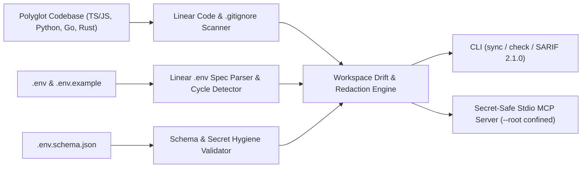

# @pie527645-cloud/env-guard-cli

Spec-compliant zero-dependency `.env` parser, polyglot source-code drift scanner, secret hygiene guard, `.env.schema.json` validator, and secret-safe Model Context Protocol (MCP) server.

## Features

- **Spec-Compliant Linear `.env` Parser & Serializer:** Supports UTF-8 BOM stripping, CRLF normalization, `#` full-line and inline comments, `export KEY=VAL`, unquoted, single-quoted, and double-quoted multiline values, escape sequences (`\n`, `\r`, `\t`, `\"`, `\\`, `\$`), `${VAR}` and `${VAR:-default}` variable interpolation with circular-reference cycle detection, and null-prototype (`Object.create(null)`) lookup maps.
- **Polyglot Code Reference Scanner:** Linear O(N) scanner across TypeScript/JavaScript (`process.env.X`, `process.env['X']`, `import.meta.env.X`), Python (`os.environ[...]`, `os.getenv`), Go (`os.Getenv`, `os.LookupEnv`), and Rust (`env::var`, `option_env!`). Respects `.gitignore` with bounded rule lengths (`<= 4096`), skips binaries and files larger than `512 KB`.
- **`.env.schema.json` Validation:** Enforces `string`, `int`, `port` (`1..65535`), `url`, `bool`, `email`, `secret` (minimum length, Shannon entropy, and placeholder rejection), `enum`, `required`, and `default` constraints without echoing raw values.
- **Secret-Safe Redaction & SARIF 2.1.0 Reporting:** Flags leaked credentials in `.env.example`, weak/placeholder values in `.env`, missing required keys, and undocumented code variables across `pretty`, `json`, `markdown`, and GitHub Code Scanning `sarif` formats (`***` redacted).
- **3 Secret-Safe MCP Tools:** Confined strictly to `--root` with canonical `realpathSync` symlink/traversal protection and a hard non-disclosure invariant (returns key names, booleans, bucketed length masks, `file:line` references, and rule compliance statuses — never raw values).

## Architecture



## Installation (From Source)

Requires **Node.js `>= 20.18.1`**.

```bash
git clone https://github.com/pie527645-cloud/env-guard-cli.git
cd env-guard-cli
npm install
npm run build
```

## CLI Usage

### 1. Audit Drift, Schema Rules & Secret Hygiene (`check`)

```bash
node dist/cli.js check .
node dist/cli.js check ./services/api --schema .env.schema.json --format pretty
node dist/cli.js check . --format sarif --fail-on high > results.sarif
```

**Options:**
- `--env <path>`: Relative path to environment file (default: `.env`)
- `--example <path>`: Relative path to example file (default: `.env.example`)
- `--schema <path>`: Relative path to schema file (default: `.env.schema.json`)
- `--format pretty|json|markdown|sarif`: Output format (default: `pretty`)
- `--fail-on critical|high|medium|low`: Minimum severity threshold returning exit code `1` (default: `medium`)

**Exit Codes:**
- `0`: All checks passed below threshold
- `1`: One or more findings met or exceeded `--fail-on`
- `2`: Invalid CLI arguments or blocked out-of-root file path

### 2. Synchronize Keys & Generate Scrubbed `.env.example` (`sync`)

```bash
node dist/cli.js sync . --format pretty
node dist/cli.js sync . --write-example --schema .env.schema.json
```

`--write-example` generates a deterministic `.env.example` containing only safe placeholders or empty assignments. Real values from `.env` are never copied.

### 3. Launch Secret-Safe MCP Server (`mcp`)

```bash
node dist/cli.js mcp --root /path/to/project
# Or directly via the MCP entrypoint:
node dist/mcp.js --root /path/to/project
```

#### MCP Client Configuration

```json
{
  "mcpServers": {
    "env-guard": {
      "command": "node",
      "args": [
        "/absolute/path/to/env-guard-cli/dist/mcp.js",
        "--root",
        "/absolute/path/to/workspace"
      ]
    }
  }
}
```

#### Exposed MCP Tools

1. `list_env_keys(subpath?)`: Lists discovered environment variable keys across source code, `.env.example`, `.env.schema.json`, and `.env` presence booleans (`hasEnvValue`, `inExample`, `maskedLength`, `codeLocations`, `validationStatus`) without exposing values.
2. `check_env_drift(subpath?)`: Returns missing, unused, undocumented, and redacted secret-hygiene findings (`***`).
3. `validate_env_schema(schemaPath?)`: Validates workspace environment variables against `.env.schema.json` rules without returning secret values.

## `.env.schema.json` Example

```json
{
  "variables": {
    "PORT": {
      "type": "port",
      "required": true,
      "default": 3000,
      "description": "HTTP listen port"
    },
    "PUBLIC_BASE_URL": {
      "type": "url",
      "required": true
    },
    "LOG_LEVEL": {
      "type": "enum",
      "values": ["debug", "info", "warn", "error"],
      "default": "info"
    },
    "ENABLE_WORKERS": {
      "type": "bool",
      "default": false
    },
    "MAX_RETRIES": {
      "type": "int",
      "min": 0,
      "max": 10,
      "default": 3
    },
    "SESSION_SECRET": {
      "type": "secret",
      "required": true,
      "minLength": 24,
      "minEntropy": 3.5
    }
  }
}
```

## Development & Testing

```bash
npm run lint
npm run build
npm test
```

## License

MIT
